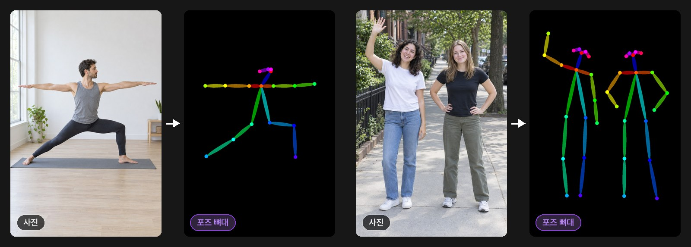
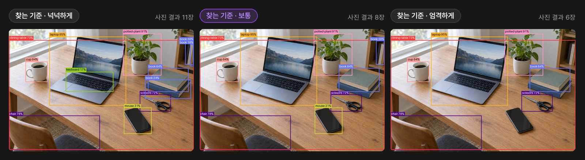
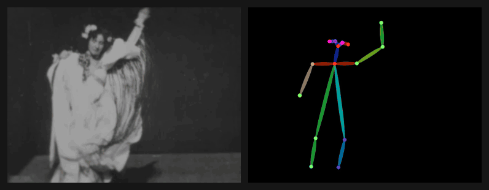
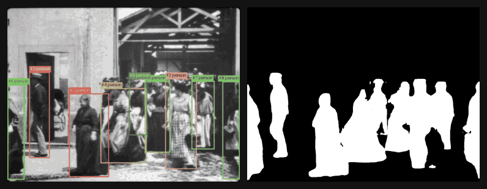
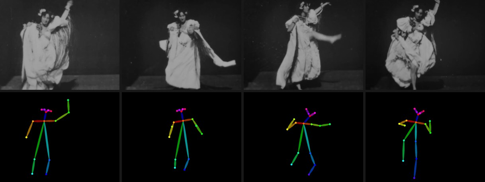
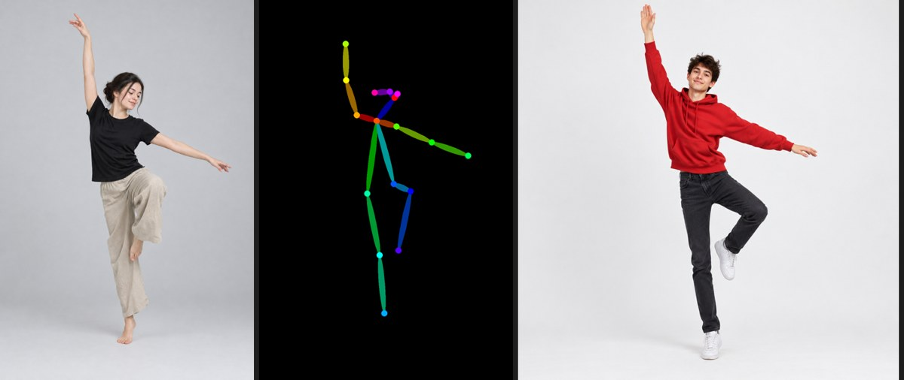
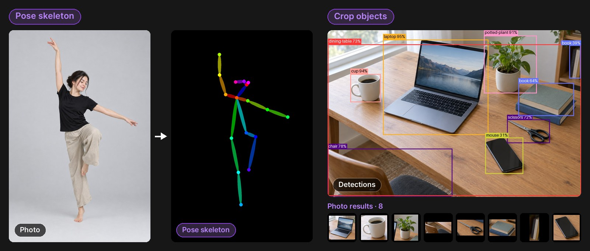
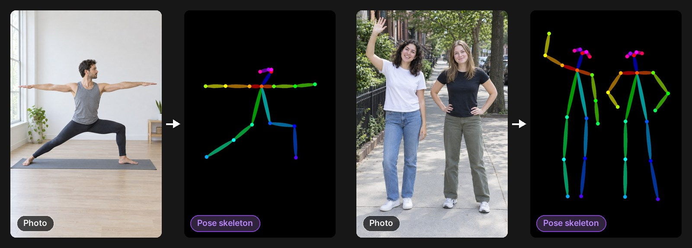
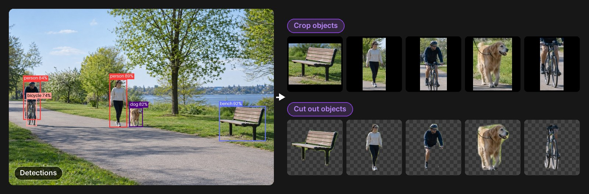
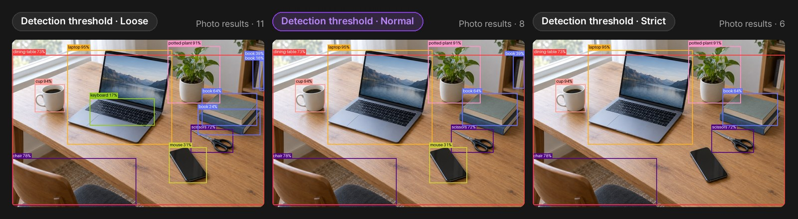

# Ultralytics YOLO — 포즈 뼈대 · 물체 잘라내기 · 찾기와 추적

PromBoard 커뮤니티 플러그인 예시입니다. 캔버스에 **YOLO 포즈 · 물체 · 추적** 노드 하나를 더합니다. 사진 · 영상 입력은 둘 다 선택이고 하나 이상 이으면 됩니다. 둘 다 이으면 둘 다 처리합니다. 모드는 노드의 모드 알약으로 고릅니다.


왼쪽은 포즈 뼈대 모드, 오른쪽은 물체 잘라내기 모드의 결과입니다. 물체 잘라내기는 찾은 것 표시(상자 + 이름)와 함께 찾은 것을 하나씩 잘라 낸 사진을 냅니다.

## 결과 예시

그림은 모두 이 저장소의 `nodes/main.py` 를 그대로 돌려 얻은 결과입니다. 찾는 기준은 따로 적지 않으면 보통이고, 예제 사진은 `cards/` 의 사진입니다.

### 사진 → 포즈 뼈대



### 사진 → 물체 잘라내기 · 물체 오려내기


물체 잘라내기는 찾은 것을 네모로 잘라 내고, 물체 오려내기는 같은 것을 배경을 지운 투명 PNG 로 냅니다(그림의 체크무늬가 투명한 부분).



찾는 기준을 넉넉하게로 두면 키보드 · 작은 책까지 더 찾고, 엄격하게로 두면 점수가 낮은 것(휴대폰을 mouse 로 잘못 찾은 상자 등)이 빠집니다.

### 영상 → 포즈 뼈대 영상



왼쪽은 원본 영상, 오른쪽은 포즈 뼈대 모드의 영상 결과입니다. 원본은 1898년 영화 「Ella Lola, a la Trilby」(퍼블릭 도메인)입니다.

### 영상 → 찾기 · 추적 영상 · 흑백 마스크 영상



물체 잘라내기 모드에 영상을 이은 결과입니다. 왼쪽은 찾기 · 추적 영상(상자 · 이름 · 추적 번호 · 이동 꼬리), 오른쪽은 영상 결과인 흑백 마스크 영상(흰색 = 찾은 사람 · 물건)입니다. 원본은 뤼미에르 형제의 1895년 영화 「La Sortie de l'usine Lumière à Lyon」(퍼블릭 도메인, [위키미디어 공용](https://commons.wikimedia.org/wiki/File:La_Sortie_de_l%27Usine_Lumi%C3%A8re_%C3%A0_Lyon_I_1895.webm))의 4~12초를 1024×768 로 줄인 것입니다.

두 움짤은 파일 크기를 줄이려고 프레임을 덜어 내고, 왼쪽 영상의 필름 잡티를 살짝 흐리게 했습니다. 플러그인이 내는 mp4 는 원본과 크기 · fps · 프레임 수가 같습니다.

## 언제 어느 포트로 나오나

| 이은 것 | 모드 | 사진 결과 | 찾은 것 표시 | 영상 결과 | 찾기 · 추적 영상 |
|---|---|---|---|---|---|
| 사진 | 포즈 뼈대 | 검은 바탕 색 뼈대 한 장 | 사진에 사람 상자 + 이름 | — | — |
| 사진 | 물체 잘라내기 | 찾은 것을 하나씩 네모로 잘라 여러 장(확실한 것부터, 64장까지) | 사진에 찾은 것 전부의 상자 + 이름 | — | — |
| 사진 | 물체 오려내기 | 같은 것을 배경을 지운 투명 PNG 여러 장 | 위와 같음 | — | — |
| 영상 | 포즈 뼈대 | — | — | 검은 바탕 색 뼈대가 움직이는 영상 | 원본 영상에 사람 상자 · 이름 · 추적 번호 · 이동 꼬리 |
| 영상 | 물체 잘라내기 · 오려내기 | — | — | 흑백 마스크 영상(흰색 = 찾은 사람 · 물건) | 원본 영상에 찾은 것 전부의 상자 · 이름 · 추적 번호 · 이동 꼬리 |

- 뼈대 영상은 영상 생성 노드의 참조 영상으로, 마스크 영상은 마스킹 팩의 '마스크 영상'과 같은 규칙(흰색 255 = 찾은 것, 검정 0 = 나머지)으로 씁니다. 식탁처럼 큰 물체도 찾으면 마스크에 들어갑니다. 줄이려면 '찾는 기준'을 엄격하게로 바꿉니다.
- 영상 결과는 브라우저에서 바로 재생되는 mp4(H.264, yuv420p)이고 원본과 크기 · fps · 프레임 수가 같습니다. **소리는 빠집니다.** yuv420p 는 짝수 크기만 되어서, 가로나 세로가 홀수인 영상은 오른쪽 · 아래에 가장자리를 1px 복제해 덧댑니다.
- 영상은 5분까지 받습니다. 그 안이어도 처음 몇 초의 속도로 어림한 처리 시간이 실행 제한(그래픽카드가 있는 PC 약 13분, 없는 PC 약 55분)을 넘으면 바로 멈추고 알립니다.
- 추적 번호: 두 프레임 연속 보인 것에만 번호를 붙이고, 가려져 놓친 것은 1초 동안 기억했다가 다시 나타나면 같은 번호를 줍니다. 한두 프레임 놓친 물체 · 관절은 직전 모양을 그대로 쓰고 마스크 · 관절 위치는 앞 프레임과 섞어 깜빡임을 줄입니다.





- 플러그인 id: `promboard.yolo`
- 모델: Ultralytics 공식 **YOLO26n** 포즈 · 분할 ONNX(각 약 12MB)를 원래 출처 [ultralytics/assets v8.4.0 릴리스](https://github.com/ultralytics/assets/releases/tag/v8.4.0)에서 받습니다. 파일마다 sha256 을 고정했습니다.
- 그래픽카드 없이 CPU 로 돕니다(onnxruntime, torch 없음). 사진 한 장에 1초 안팎, 영상은 28스레드 데스크톱 CPU 실측으로 1080p 한 프레임에 약 75ms(1080p 30fps 10초 → 약 23초), 720×1280 은 약 45ms 입니다. 느린 노트북은 몇 배 걸립니다.
- '찾는 기준' 알약: 넉넉하게 · 보통 · 엄격하게(찾았다고 볼 점수 0.15 · 0.25 · 0.45).

## 들어 있는 것

- 예제 사진 5장(참조 이미지 카드): 춤추는 사람 · 요가 자세 · 두 친구(포즈용), 책상 위 물건 · 공원 산책길(물체용). GPT Image 2.5 로 만든 사진입니다.
- 워크플로우 「사진 → 포즈 뼈대 → 같은 자세로 새 인물」: 소스 이미지 → YOLO(포즈 뼈대) → 이미지 노드(뼈대를 참조 그림으로) + 프롬프트 노드. 소스 이미지에 사진을 올리고 YOLO 노드 ▷, 이미지 노드 ▷ 를 차례로 누릅니다. 참조 그림을 받는 이미지 모델을 고르세요.
- 워크플로우 「영상 → 포즈 뼈대 영상 → 같은 동작으로 새 인물」: 소스 영상 → YOLO(포즈 뼈대, 영상 결과) → 영상 노드(뼈대 영상을 소스 영상 칸에, 모델 Seedance 2.0) + 프롬프트 노드. 소스 영상에 몸 전체가 보이는 2~15초 영상을 올리고 YOLO 노드 ▷, 영상 노드 ▷ 를 차례로 누릅니다. Seedance 2.0 이 내 PC 의 영상을 참조로 받으려면 설정 → AI 연결에 fal.ai 키가 있어야 합니다(BytePlus Ark 키만으로는 보낼 수 없어 그 선이 흐리게 남고 생성에서 빠집니다). 뼈대 영상을 영상 노드에 바로 잇는 것은 앱 1.0.2 부터입니다. 1.0.1 에서는 YOLO 의 영상 결과를 내려받아 소스 영상 노드에 올려 이어 주세요. 썸네일의 원본은 Thomas A. Edison, Inc. 의 1898년 영화 「Ella Lola, a la Trilby」(퍼블릭 도메인, 미국 의회도서관 보존본, [위키미디어 공용](https://commons.wikimedia.org/wiki/File:Ella_Lola,_a_la_Trilby.webm))이고, 아래 줄은 이 플러그인으로 뽑은 뼈대 영상입니다.

## 설치

1. PromBoard 앱 → 플러그인 매니저 → **커뮤니티 플러그인** → 둘러보기에서 설치합니다.
2. 코드가 든 플러그인이라 **제한 모드**를 끄고 플러그인을 켭니다.
3. 처음 실행할 때 실행 준비가 파이썬 패키지(onnxruntime · numpy · Pillow · PyAV)와 모델 2개(약 23MB)를 받습니다(한 번만). PyAV 는 영상 읽기 · 쓰기용이고 운영체제별 약 18~36MB 입니다.
4. 캔버스 빈 곳을 우클릭하면 메뉴 맨 아래 플러그인 묶음에 **YOLO 포즈 · 물체 · 추적**이 있습니다.

## 플러그인 만드는 사람을 위한 메모

```
manifest.json               플러그인 정보 · 노드 정의(layout grid, 입력 2 · 출력 4) · 모델(requires.models)
nodes/main.py               NODES = {"yolo": 함수} — 레터박스 전처리, end2end 출력 읽기, OpenPose 색 뼈대, 분할 마스크,
                            작은 ByteTrack(칼만 필터 + 두 번 짝짓기), PyAV 로 영상 읽기 · H.264 쓰기
nodes/requirements*.txt     받을 패키지 · 운영체제별 해시 잠금 파일
cards/                      예제 사진(참조 이미지 카드)
workflows/                  워크플로우 2개와 썸네일(앱의 워크플로우 저장 모양 그대로)
docs/                       이 README 의 그림 · 움짤(ko · en, 움짤은 두 언어 공용). 플러그인 zip 에는 넣지 않는다
```

- 레지스트리에 올리는 zip 은 PromBoard 앱 저장소의 `server/src/tools/packPlugin.ts` 로 만듭니다. `packPlugin.ts` 는 넘겨받은 폴더를 통째로 묶으므로 `git archive HEAD` 로 꺼낸 폴더를 넘깁니다. `.gitattributes` 의 `export-ignore` 로 `docs/` 가 빠집니다.

- YOLO26 ONNX 는 NMS 가 모델 안에 들어 있어(end2end) 출력이 `(1, 300, 6 + 추가)` 입니다: `[x1, y1, x2, y2, 점수, 종류, …]`(640 레터박스 좌표). 포즈는 추가가 관절 17개 × (x, y, 점수), 분할은 마스크 계수 32개 + 마스크 바탕 `(1, 32, 160, 160)`.
- 종류가 다른 같은 물체를 두 번 찾는 일이 있어 겹침(IoU 0.7 이상)을 한 번 더 거릅니다.
- 추적기는 ByteTrack 을 줄여 손으로 짰습니다. Roboflow `supervision`(MIT)에도 ByteTrack 이 있지만 opencv · scipy · matplotlib 를 함께 끌고 와서 쓰지 않았습니다.
- 출력 포트가 하나의 종류만 가질 수 있어서 찾기 · 추적은 사진용(image) · 영상용(video) 포트 둘로 나눴습니다. 이어진 입력이 없는 쪽 포트는 결과를 내지 않습니다.
- 잠금 파일 다시 만들기: `uv pip compile nodes/requirements.in --generate-hashes --python-version 3.12 --python-platform x86_64-pc-windows-msvc --index-url https://pypi.org/simple --exclude-newer 2026-10-10T00:00:00Z -o nodes/requirements-win.txt` (맥은 `MACOSX_DEPLOYMENT_TARGET=14.0` + `aarch64-apple-darwin`, 리눅스는 `x86_64-unknown-linux-gnu`).

---

## English

A PromBoard community plugin example. It adds one **YOLO pose · objects · tracking** node (`YOLO 포즈 · 물체 · 추적`) to the canvas. The photo and video inputs are both optional; connect at least one. If both are connected, both are processed. Pick the mode with the node's pill.



Left is the pose skeleton mode, right is the crop objects mode. Crop objects returns the detections (boxes + names) together with one cropped photo per object.

### Examples

All pictures come from running this repository's `nodes/main.py` as is, on the example photos in `cards/`. The threshold is normal unless stated otherwise.





Crop objects cuts each detection out as a rectangle; cut out objects returns the same detections as transparent PNGs (the checkerboard is the transparent part).



The loose threshold also finds the keyboard and small books; the strict threshold drops low-score detections such as the phone wrongly found as a mouse.


Video in pose skeleton mode: source on the left, video result on the right. The source is the 1898 film "Ella Lola, a la Trilby" (public domain).


Video in crop objects mode: the detection & tracking video (boxes, names, track IDs, motion trails) on the left and the video result, a black-and-white mask video (white = detected people and objects), on the right. The source is seconds 4–12 of the Lumière brothers' 1895 film "La Sortie de l'usine Lumière à Lyon" (public domain, [Wikimedia Commons](https://commons.wikimedia.org/wiki/File:La_Sortie_de_l%27Usine_Lumi%C3%A8re_%C3%A0_Lyon_I_1895.webm)), scaled to 1024×768.

Both animations drop frames and slightly blur the film grain of the left video to keep the files small. The MP4 files the plugin writes keep the source size, fps and frame count.

### Ports

| Connected | Mode | Photo result (`images`) | Detections (`found`) | Video result (`video`) | Detection & tracking video (`found-video`) |
|---|---|---|---|---|---|
| Photo | Pose skeleton | One OpenPose-colored skeleton on black | Photo with person boxes + names | — | — |
| Photo | Crop objects | Each detected object cropped as a rectangle (most confident first, up to 64) | Photo with boxes + names of everything found | — | — |
| Photo | Cut out objects | The same objects as transparent PNGs | Same as above | — | — |
| Video | Pose skeleton | — | — | Moving skeleton video on black | Source video with person boxes, names, track IDs and short motion trails |
| Video | Crop / cut out objects | — | — | Black-and-white mask video (white = detected people and objects) | Source video with boxes, names, track IDs and trails for everything found |

- Use the skeleton video as a reference video for video generation nodes. The mask video follows the masking pack's rule (white 255 = found, black 0 = rest). Large objects such as dining tables are included when found; use the strict threshold to find fewer things.
- Video results are browser-playable MP4 (H.264, yuv420p) with the same size, fps and frame count as the source. **Audio is dropped.** yuv420p needs even dimensions, so odd widths or heights get one replicated edge pixel on the right or bottom.
- Videos up to 5 minutes are accepted. If the time estimated from the first few seconds exceeds the run limit (about 13 minutes on PCs with a graphics card, about 55 minutes without), the node stops early and says so.
- Track IDs are given only to objects seen in two consecutive frames; an object lost behind something keeps its ID for one second. Objects and joints missed for one or two frames keep their previous shape, and masks and joint positions are blended with the previous frame to reduce flicker.
- Plugin id: `promboard.yolo`
- Models: official Ultralytics **YOLO26n** pose and segmentation ONNX files (about 12 MB each), downloaded from the original source ([ultralytics/assets v8.4.0](https://github.com/ultralytics/assets/releases/tag/v8.4.0)) with pinned sha256.
- Runs on the CPU with onnxruntime (no torch, no graphics card). About one second per photo; for video about 75 ms per 1080p frame and 45 ms per 720×1280 frame on a 28-thread desktop CPU (a 10-second 1080p 30 fps clip takes about 23 seconds). Slow laptops take several times longer.
- Includes five example photos (reference image cards, made with GPT Image 2.5) and two workflows: "photo → pose skeleton → new person in the same pose" and "video → pose skeleton video → new person with the same motion" (Seedance 2.0 video node with the skeleton video in its source video slot). Seedance 2.0 can take a video from your PC as a reference only through a fal.ai key (Settings → AI connections); with a BytePlus Ark key alone the wire stays dimmed and is left out of the request. Connecting the skeleton video straight to the video node works from app 1.0.2; on 1.0.1, download YOLO's video result and upload it to a source video node instead. The video workflow thumbnail uses "Ella Lola, a la Trilby" (Thomas A. Edison, Inc., 1898, public domain, Library of Congress copy on [Wikimedia Commons](https://commons.wikimedia.org/wiki/File:Ella_Lola,_a_la_Trilby.webm)) with the skeleton video this plugin extracted from it.
- **Install**: PromBoard → Plugin Manager → **Community plugins** → Browse → install. Turn off **Restricted mode** and enable the plugin. The first run prepares the Python packages (onnxruntime, numpy, Pillow, PyAV — PyAV is about 18–36 MB per OS) and the two models (about 23 MB, once). Right-click an empty spot on the canvas: the node is in the plugin group at the bottom of the menu.

The plugin texts in the app are Korean only for now — the plugin manifest takes a single language.

## License

AGPL-3.0 — see [LICENSE](LICENSE). The YOLO26 weights are © Ultralytics, licensed under [AGPL-3.0](https://ultralytics.com/license), and are downloaded from Ultralytics' release, not bundled. onnxruntime (MIT), numpy (BSD-3-Clause), Pillow (MIT-CMU) and PyAV (BSD-3-Clause; its wheels bundle FFmpeg under LGPL-3.0 and x264 under GPL-2.0-or-later) are installed from PyPI at prepare time. The tracker is a small re-implementation of the ByteTrack method (Zhang et al., 2022) written for this plugin.
